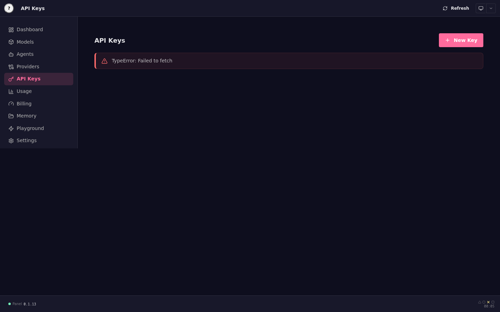

# Web UI —— 從第一句話開始的旅程

一個帳戶、一把金鑰、一段對話。本頁走的正是產品走的路——模型變得可用、金鑰為它認證、一輪對話帶著記憶執行，面板再把它變成你能操作的東西。

## 模型：從來源到呼叫

一個模型從「存在」走到「可供對話」，要經過四個階段：**來源**（提供者型錄——是元資料，不是推論）→ **註冊**（一個後端，可以是本機執行環境或任何 OpenAI 相容服務；重啟後仍留存）→ **部署**（模型 ID 交給某個節點，由它下載並啟動執行環境）→ **路由**（以在途請求最少為準的負載平衡，並具工作階段親和性）。尚未通過首次健康探測的後端會被拒絕，而不是先試再說。

## 身分與計量

**API 金鑰**就是你的身分——閘道以 Bearer token 驗證，`curl` 與工作台都得在門口出示一把。**用量**是每把金鑰的逐次呼叫帳本：token 數、模型、後端、成本。**帳務**按等級設定配額；觸頂便是硬性拒絕，而不是放慢速度。

## 對話與記憶

每一輪對話都會經過記憶服務——每輪上的徽章會告訴你它是否真的經過。`Memory on` 表示路由前已注入相關的長期記憶；`Memory offline` 表示記憶服務連不上（誠實訊號，不是 bug）；`disabled` 表示沒有找到相關內容。完成的對話輪會被萃取並持久化，因此記憶能在重啟後留存——而回寫條目可以直接在 Memory 頁面刪除。

## 面板與工業控制

一段提示詞就能生出一塊面板；引擎生成版面配置，並把它持久化進工作區。編輯是結構性的——資料來源綁定、元件清單、連線狀態——不是黑盒子。Topology 與 Holographic 是同一機群的兩種視圖；Reports 再為歷史加上語意搜尋。工業寫入必須先通過策略校驗與**人工核准**，一切才會動作：這是閉環的終點，也是最沉重的一步。

## 深入閱讀

- [Arona](../platforms/arona.md) —— 閘道與部署面板。
- [Shittim Chest](../platforms/chest.md) —— 工作台與其面板。
- [Entelecheia](../platforms/entelecheia.md) —— 智能體、工作區與工業寫入閘門。
